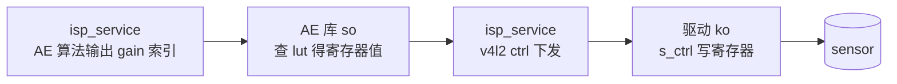

# V4L2 Camera 调试总览

## 范围

- 本章节概述 V4L2 模式下 Camera Bring-Up 的流程，帮助读者掌握 v4l2 subdev 驱动框架与接入方式。
- 说明如何新增 V4L2 sensor 配置并点亮 Camera。
- 各专题具体实现（v4l2 sensor 驱动编写、GMSL SerDes 接口、深度相机）与常见问题见下方「文档组成」。

## 文档组成

| 章节                                                                                                                       | 说明                                                         |
| ------------------------------------------------------------------------------------------------------------------------- | ------------------------------------------------------------ |
| [V4L2 mipi sensor 驱动编写说明](/Advanced_development/multimedia_development/multimedia_api/sensor_bringup/bringup/v4l2/mipi/sensor_driver)       | v4l2 subdev 驱动框架：私有结构体、回调 ops、probe、device tree |
| [V4L2 GMSL SERDES camera 驱动编写说明](/Advanced_development/multimedia_development/multimedia_api/sensor_bringup/bringup/v4l2/serdes/gmsl_serdes)     | GMSL sensor serdes 接口、dtbo、gain LUT、曝光同步、深度相机   |
| [imx219 Sensor Bring-Up](/Advanced_development/multimedia_development/multimedia_api/sensor_bringup/bringup/v4l2/mipi/imx219)                 | MIPI 直连 v4l2 sensor 适配（以 imx219 为例）                             |
| [Camera Sensor FAQ](/Advanced_development/multimedia_development/multimedia_api/sensor_bringup/bringup/camera_faq)                               | I2C/MIPI/Sensor 常见问题与排查方法                            |

建议先通读本文掌握 v4l2 subdev 框架与 dtbo 接入方式，再按场景阅读对应分章节。

---

## 准备工作

- **软件资源**：系统 BSP、sensor datasheet、sensor 的初始化序列、v4l2 sensor 驱动源码（`kernel/drivers/media/i2c/`）。
- **硬件资源**：RDK 开发板及待适配的 Camera 模组、原理图和 PCB，详见 [模组硬件信息](/Advanced_development/multimedia_development/multimedia_api/sensor_bringup/bringup/module_check#模组硬件信息)。

各平台 MIPI RX 路数、I2C 资源不同：

:::doc_scope{products="RDK S100"}
S100：3 路 MIPI RX（RX0/RX1/RX4），每路 4VC；I2C1/2/3。
:::

:::doc_scope{products="RDK S600"}
S600：6 路 MIPI RX（RX0-RX5），每路 4VC；I2C0-5。
:::

---

## V4L2 subdev 驱动框架概要

S100 Camsys sensor v4l2 驱动软件框架为标准的 v4l2 sub device 驱动。
<!--  -->

- **私有结构体**：含 `struct v4l2_subdev sd`、`struct media_pad pad`、`struct i2c_client *`、`struct v4l2_ctrl_handler` 等。
- **subdev ops**：实现 `v4l2_subdev_ops`（core/video/pad）+ `v4l2_subdev_internal_ops`，由 V4L2 框架回调控制 sensor。
- **probe 注册**：`devm_kzalloc` 分配 → `v4l2_i2c_subdev_init` 绑定 i2c → 读 chip id 校验 → 初始化 v4l2_ctrl → `media_entity_pads_init` → `v4l2_async_register_subdev_sensor` 异步注册。
- **media 链接**：sensor 作为一个 source pad，通过 media controller 与后级（mipi_csi / cim / isp / pym / gdc / ynr）建立链接。

imx219 实例见 [imx219 Sensor Bring-Up](/Advanced_development/multimedia_development/multimedia_api/sensor_bringup/bringup/v4l2/mipi/imx219)，完整框架细节见 [V4L2 mipi sensor 驱动编写说明](/Advanced_development/multimedia_development/multimedia_api/sensor_bringup/bringup/v4l2/mipi/sensor_driver)。

---

## AE库 / 驱动 / isp_service 关系

RAW sensor 对接 ISP，AE 控制涉及三者协作：

- **驱动（ko）**：sensor v4l2 subdev 驱动（如 `imx219.ko`），提供 `v4l2_ctrl`（exposure / gain）接口，`s_ctrl` 回调写 sensor 寄存器。
- **isp_service（用户态进程）**：承载 AE/AWB 等 3A 算法，`nohup isp_service &` 启动。
- **AE 库（`lib<sensor_name>_v4l2.so`）**：sensor 专属，存放 gain lut（ISP gain 索引 → sensor 寄存器值映射）；isp_service 运行时 dlopen 匹配当前 sensor 的 so。

数据流：

YUV sensor（板端 ISP bypass）无此链路；RAW sensor 必备 AE 库。gain lut 编写见 [Sensor gain LUT 表编写说明](/Advanced_development/multimedia_development/multimedia_api/sensor_bringup/bringup/v4l2/serdes/gmsl_serdes#sensor-gain-lut-表编写说明)。

---

## V4L2 接入方式

V4L2 模式下，sensor 作为标准 v4l2 subdev 接入 v4l2 框架，区别于 HBN 模式的 `sensor_module_t` + vcon 体系：

- sensor 驱动实现 `v4l2_subdev_ops`（core/video/pad），通过 `v4l2_async_register_subdev_sensor` 异步注册。
- 与后级模块通过 media controller 的 pad 建立链接关系。
- 驱动编写详见 [V4L2 mipi sensor 驱动编写说明](/Advanced_development/multimedia_development/multimedia_api/sensor_bringup/bringup/v4l2/mipi/sensor_driver)。

接入方式分两类：

- **MIPI 直连 sensor**：sensor 直接到 SoC MIPI RX。dts 在 i2c 节点下描述 sensor 及 endpoint，对接到 `mipi_host`。接入非默认 sensor 时用 dtbo overlay 覆盖默认 dts。实例见 [imx219 Sensor Bring-Up](/Advanced_development/multimedia_development/multimedia_api/sensor_bringup/bringup/v4l2/mipi/imx219)。
- **GMSL/SerDes sensor**：sensor 经加串器/解串器接入，sensor dts 配置 `d-robotics,serdes-ser-device` / `d-robotics,serdes-dser-device` 指向 ser/des 节点；驱动通过 `serdes_core.h` 的 `SERDES_OP` 操作加解串器。详见 [V4L2 GMSL SERDES camera 驱动编写说明](/Advanced_development/multimedia_development/multimedia_api/sensor_bringup/bringup/v4l2/serdes/gmsl_serdes)。

---

## 新 sensor 点亮步骤

1. **编写 sensor v4l2 驱动**：实现 `v4l2_subdev_ops`、probe、media pad，见 [V4L2 mipi sensor 驱动编写说明](/Advanced_development/multimedia_development/multimedia_api/sensor_bringup/bringup/v4l2/mipi/sensor_driver)。
2. **配置 device tree / dtbo**：使用默认 sensor dts 或编写 dtbo overlay 覆盖，见对应分章节。
3. **制作 gain LUT so**（RAW sensor）：生成 `lib<sensor_name>_v4l2.so`，见 [gain LUT 表编写](/Advanced_development/multimedia_development/multimedia_api/sensor_bringup/bringup/v4l2/serdes/gmsl_serdes#sensor-gain-lut-表编写说明)。
4. **板端加载与验证**：加载 v4l2 ko，用 v4l2-ctl / get_vin_data 查看 raw 图与帧率。

---

## 板端验证

- **v4l2-ctl**：`v4l2-ctl --device=/dev/videoX --list-formats-ext` 确认 sensor 出流格式与帧率。
- **get_vin_data**：查看 raw 图质量与帧率。
- **预览**：深度相机用 `realsense-viewer`（D457）或 orbbec viewer（335Lg）；普通 camera 用 hbplayer。

常见问题见 [Camera Sensor FAQ](/Advanced_development/multimedia_development/multimedia_api/sensor_bringup/bringup/camera_faq)。

## 小结

- V4L2 模式以标准 v4l2 subdev 框架接入 sensor，与 HBN 的 `sensor_module_t` 体系并行。
- 流程：编写 v4l2 驱动 → 配置 dts/dtbo → 制作 gain LUT → 板端加载验证。
- GMSL sensor 额外涉及 serdes 接口与深度相机适配，见对应章节。
